<p align="center"></p>

**Jose Manuel Rojas** · Ingeniería de Sistemas, Universidad Icesi (séptimo semestre)

Construyo agentes, RAG y modelos con pruebas, guardias y revisión humana. Busco práctica profesional y proyectos de IA aplicada.

*AI systems you can verify. Looking for an internship in applied AI.*

[**Portafolio**](https://jmrojas06.github.io) · [CV en PDF](https://jmrojas06.github.io/Jose-Manuel-Rojas-CV-ES.pdf) · [CV in English](https://jmrojas06.github.io/Jose-Manuel-Rojas-CV-EN.pdf) · [LinkedIn](https://www.linkedin.com/in/jose-manuel-rojas-401587226) · [Escríbeme por WhatsApp](https://wa.me/573182650920?text=Hola%20Jose%2C%20vi%20tu%20portafolio%20web%20y%20me%20gustar%C3%ADa%20conversar%20contigo.)


## Cifras que puedo defender

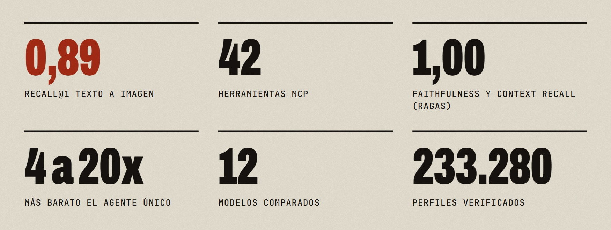

<sub>Cada cifra sale de un archivo de un proyecto, con su estado real. Los benchmarks son pequeños y el portafolio lo dice en cada tarjeta.</sub>


## Cómo trabajo con IA

<table>
<tr>
<td width="33%" valign="top">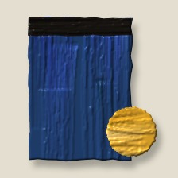<br><b>Primero el contrato, después el código.</b></td>
<td width="33%" valign="top"><br><b>Cada agente en su carril.</b></td>
<td width="33%" valign="top">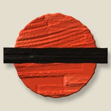<br><b>Lo peligroso se bloquea.</b></td>
</tr>
<tr>
<td width="33%" valign="top">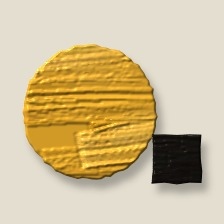<br><b>Probado o no está hecho.</b></td>
<td width="33%" valign="top">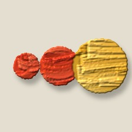<br><b>Dos fallos y entra una persona.</b></td>
<td width="33%" valign="top">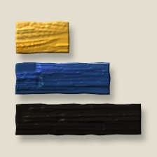<br><b>Memoria por capas.</b></td>
</tr>
</table>


## Proyectos

<table>
<tr>
<td width="88" valign="top" align="center">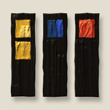</td>
<td valign="top"><b><a href="https://github.com/jmrojas06/AgentSprint">AgentSprint: tablero de sprints que le da memoria a los agentes de código</a></b> &nbsp;<code>Publicado en npm, v0.2.1</code><br>Un tablero de sprints que vive en Git y le da memoria a los agentes de código: cada sesión empieza con un resumen de dónde quedó el proyecto y termina con un traspaso para la siguiente.</td>
</tr>
<tr>
<td width="88" valign="top" align="center">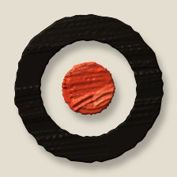</td>
<td valign="top"><b><a href="https://jmrojas06.github.io/#p-rag">RAG multimodal: recuperación y fusión entre modalidades</a></b> &nbsp;<code>Investigación</code><br>Estudio experimental de cómo recuperar y combinar evidencia de texto, imagen, audio y tablas en un sistema RAG, con resultados y límites reportados sin maquillaje.</td>
</tr>
<tr>
<td width="88" valign="top" align="center">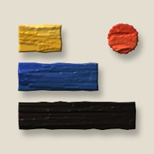</td>
<td valign="top"><b><a href="https://github.com/jmrojas06/Reto-2">Memoria de tres niveles y servidores MCP para agentes</a></b> &nbsp;<code>Reto de clase</code><br>Un gestor que le da memoria a un asistente en tres niveles, un RAG sobre PDF evaluado con RAGAS y dos servidores MCP para conectar herramientas a un agente.</td>
</tr>
<tr>
<td width="88" valign="top" align="center">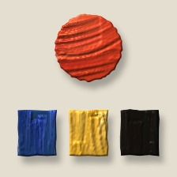</td>
<td valign="top"><b><a href="https://github.com/jmrojas06/multiagente-tostaduria">Arquitectura multiagente medida: ¿vale la pena un equipo de agentes?</a></b> &nbsp;<code>Investigación</code><br>Un sistema de agentes (orquestador, investigadores en paralelo, redactor y crítico) comparado contra un agente único con modelos reales, midiendo calidad, costo, latencia y costo de coordinación.</td>
</tr>
<tr>
<td width="88" valign="top" align="center">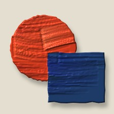</td>
<td valign="top"><b><a href="https://jmrojas06.github.io/#p-winback">Winback: predicción de reactivación y chatbot de WhatsApp</a></b> &nbsp;<code>En desarrollo</code><br>Modelo que estima la probabilidad de que un afiliado retirado se reactive en 12 meses, para decidir a quién contactar primero, más un chatbot que conversa y pasa a un asesor a quien quiere volver.</td>
</tr>
<tr>
<td width="88" valign="top" align="center">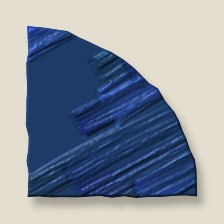</td>
<td valign="top"><b><a href="https://jmrojas06.github.io/#p-rytm">Rytm: coach híbrido de pesas y carrera</a></b> &nbsp;<code>Prototipo desplegado</code><br>PWA instalable en iPhone que guía la sesión de pesas serie a serie, cronometra el cardio, genera un plan a medida y suma un coach con IA y una red social.</td>
</tr>
</table>

Hay más (Shift OS, CRM de WhatsApp, motor de video por código y un bot de Instagram) en el [portafolio](https://jmrojas06.github.io/#proyectos).


<!-- VIVO:INICIO -->
## Lo último que subí

Se actualiza solo cada semana con mis repositorios públicos.

| Repositorio | Qué es | Lenguaje | Último cambio |
|---|---|---|---|
| [multiagente-tostaduria](https://github.com/jmrojas06/multiagente-tostaduria) | Arquitectura multiagente (LangGraph y desde cero) con DeepSeek: diseño, implementación y medición de cos… | Jupyter Notebook | 3 nov 2026 |
| [Reto-2](https://github.com/jmrojas06/Reto-2) | Reto 2 - Inteligencia Artificial: servidores MCP y memoria RAG | Python | 3 nov 2026 |
| [AgentSprint](https://github.com/jmrojas06/AgentSprint) | Tablero de sprints en Git que le da memoria a los agentes de código: servidor MCP, 10 agentes y filtro d… | TypeScript | 25 oct 2026 |

**Lenguajes de mis repositorios públicos**

```text
TypeScript        ████████████  2
Java              ████████████  2
Jupyter Notebook  ██████░░░░░░  1
Python            ██████░░░░░░  1
```

<sub>Actualizado el 12 nov 2026 por una GitHub Action. Aquí solo aparece lo público.</sub>
<!-- VIVO:FIN -->


<table>
<tr>
<td width="110" valign="middle">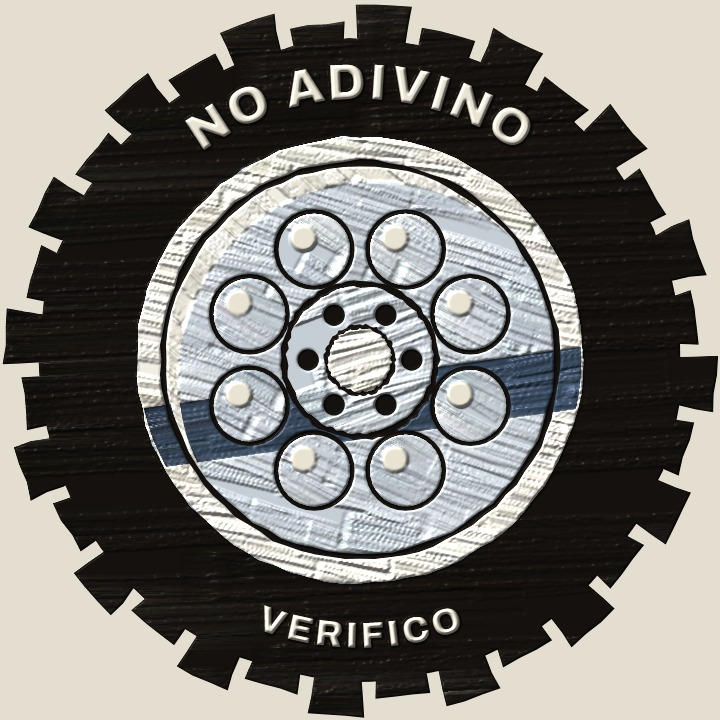</td>
<td valign="middle"><b>Hecho para durar.</b> Los de antes se hacían para durar décadas: pocas piezas, a la vista y fáciles de reparar. Quiero que mi código sea igual. <sub>Todo lo que ves está pintado con código.</sub></td>
</tr>
</table>
